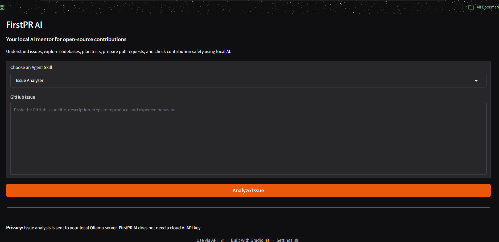
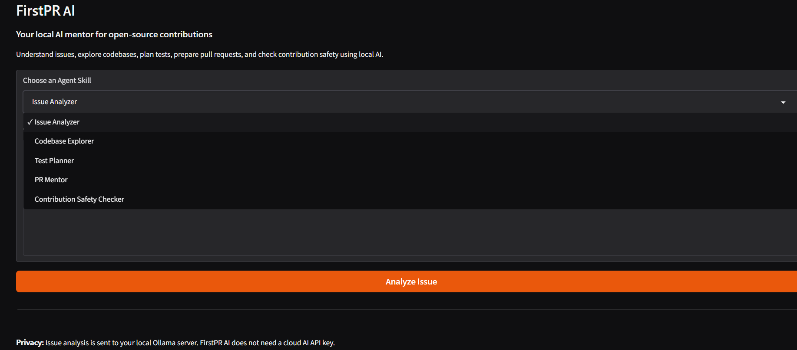
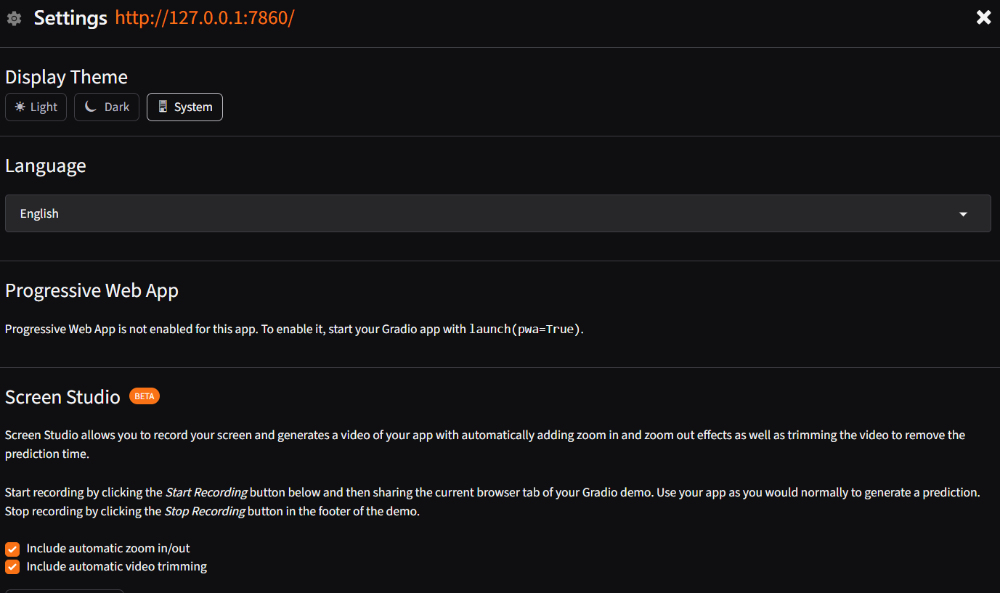

# FirstPR AI

**A beginner-friendly AI mentor for open-source contributors.**

FirstPR AI helps contributors understand GitHub issues, explore unfamiliar codebases, plan tests, prepare pull requests, and review potentially risky contribution steps. It provides two ways to use AI:

- **Local mode:** Gradio + Ollama. Prompts go to the Ollama server configured on your machine; no cloud API key is required.
- **Hosted mode:** a static website + Vercel serverless API + Groq. Prompts are sent to the configured cloud provider. Do not submit secrets or confidential source code.

[Project website](https://firstpr-ai.vercel.app) · [GitHub repository](https://github.com/prabhtheone/FirstPR-AI)

## Skills

| Skill | Purpose |
| --- | --- |
| Issue Analyzer | Turn an issue into a clear problem statement and investigation plan. |
| Codebase Explorer | Plan how to navigate an unfamiliar repository without inventing its structure. |
| Test Planner | Identify positive, negative, edge, and regression tests. |
| PR Mentor | Prepare a small, reviewable contribution and an accurate PR description. |
| Contribution Safety Checker | Review commands and contribution steps for risk and reversibility. |

The Markdown instructions in `skills/` are the source of truth. Both the local app and hosted API load the same files through `skill_registry.py`; skill guidance is not copied into a second Python dictionary.

## Screenshots







## Run locally

### Requirements

- Python 3.10 or newer
- [Ollama](https://ollama.com/download)
- Git

### Setup

```bash
git clone https://github.com/prabhtheone/FirstPR-AI.git
cd FirstPR-AI
python -m venv .venv
```

Activate the environment:

**macOS / Linux**
```bash
source .venv/bin/activate
```

**Windows PowerShell**
```powershell
.\.venv\Scripts\Activate.ps1
```

Install and start:

```bash
python -m pip install -r requirements.txt
ollama pull llama3.2:3b
python app.py
```

Keep Ollama running. Open [http://127.0.0.1:7860](http://127.0.0.1:7860).

If PowerShell blocks activation, run `.venv\Scripts\python.exe -m pip install -r requirements.txt` and `.venv\Scripts\python.exe app.py` instead.

## Hosted mode

The hosted website is served from `web/index.html`; requests are handled by `web/api/chat.py`.

Configure these environment variables in the Vercel project:

- `GROQ_API_KEY` — required secret.
- `GROQ_MODEL` — optional; defaults to `llama-3.3-70b-versatile`.

Never commit the API key. Cloud mode sends the user's prompt to Groq for processing. Local mode is separate and uses Ollama.

## Project layout

```text
FirstPR-AI/
├── app.py                    # Local Gradio application
├── skill_registry.py         # Shared skill names and Markdown loader
├── skills/                   # One source of truth for agent instructions
│   ├── issue-analyzer/
│   ├── codebase-explorer/
│   ├── test-planner/
│   ├── pr-mentor/
│   └── contribution-safety-checker/
├── screenshots/               # UI documentation images
├── web/
│   ├── index.html            # Hosted website and browser UI
│   └── api/
│       └── chat.py           # Hosted Groq API endpoint
├── tests/
│   └── test_app.py           # Network-free local regression tests
├── .github/workflows/ci.yml
├── requirements.txt
├── CONTRIBUTING.md
├── SECURITY.md
└── LICENSE
```

## Checks

Run from the repository root:

```bash
python -m compileall -q app.py skill_registry.py web/api tests
python -m unittest discover -s tests -v
```

The unit tests mock Ollama; they do not require a running model or network access. GitHub Actions runs the syntax check and tests on pushes and pull requests to `main`.

## Privacy and limitations

- Local mode sends prompts to the Ollama endpoint configured in `app.py`.
- Hosted mode sends prompts to Groq through the Vercel function.
- AI output can be inaccurate or incomplete. Verify commands, repository paths, and technical claims before acting.
- Never submit passwords, access tokens, private keys, or confidential project data.
- FirstPR AI provides guidance; it does not automatically modify repositories or guarantee that a suggested contribution is safe.

## Contributing

Bug reports, documentation improvements, and focused code contributions are welcome. Read [CONTRIBUTING.md](CONTRIBUTING.md) before opening a pull request.

## License

Released under the [MIT License](LICENSE).
